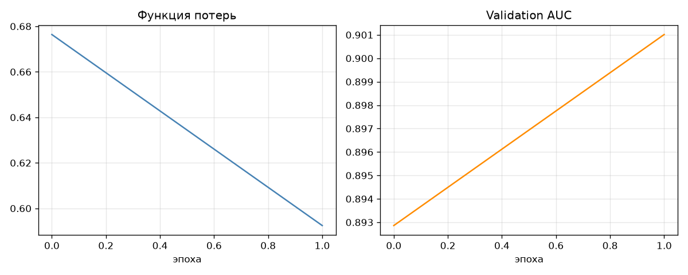

# ❤️ ECG Analyzer — классификация ЭКГ нейросетью

Учебный проект: приложение для анализа электрокардиограмм с помощью
глубокого обучения. Модель обучена на датасете
[PTB-XL](https://physionet.org/content/ptb-xl/) и классифицирует ЭКГ
по 5 диагностическим категориям.

> ⚠️ **Дисклеймер:** проект носит учебный характер, не является
> медицинским изделием и не предназначен для диагностики.


## Возможности

- 📁 Загрузка 12-отведённой ЭКГ в формате CSV
- 📈 Визуализация сигнала (все 12 отведений)
- 🤖 Классификация по 5 суперклассам PTB-XL
- 📊 Вероятности диагнозов с настраиваемым порогом
- 💻 Полностью локальная работа (без отправки данных в интернет)

## Классы

| Код | Расшифровка | Описание |
|-----|-------------|----------|
| NORM | Норма | Здоровая ЭКГ |
| MI | Инфаркт миокарда | Признаки перенесённого/острого инфаркта |
| STTC | Изменения ST/T | Нарушения реполяризации |
| CD | Нарушения проводимости | Блокады, аритмии проводящей системы |
| HYP | Гипертрофия | Утолщение стенок сердца |

## Результаты

Тестовая выборка: **fold 10** (2 203 записи), метрика — macro AUC.

| Класс | AUC | F1 |
|-------|-----|-----|
| NORM | 0.9409 | 0.8526 |
| MI | 0.9295 | 0.7237 |
| STTC | 0.9257 | 0.7481 |
| CD | 0.9178 | 0.7397 |
| HYP | 0.8332 | 0.4415 |
| **macro** | **0.9094** | **0.7011** |

Для сравнения: бенчмарк Strodthoff et al. (2021) на суперклассах PTB-XL —
macro AUC ≈ 0.928 при значительно более тяжёлых архитектурах.



## Модель

- **Архитектура:** лёгкий 1D ResNet (4 residual-блока)
- **Параметры:** ~200K (см. `models/model_card.json`)
- **Вход:** $(12, 1000)$ — 12 отведений × 1000 отсчётов (100 Гц × 10 с)
- **Выход:** 5 сигмоид (мультилейбл-классификация)
- **Функция потерь:** `BCEWithLogitsLoss` с весами классов
- **Обучение:** 14 эпох (early stopping), batch 64, Adam

## Как запустить

### 1. Клонировать репозиторий

```bash
git clone https://github.com/nikan-13/ecg-analyzer.git
cd ecg-analyzer